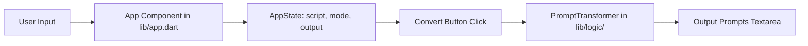

# Requirements

### Overview & Goals
Recreate the client-side web application `script_prompter` using Jaspr, converting raw scripts into shortened cue-card prompts. The application supports two distinct prompt generation modes: a new default **First letters** mode (reducing each word to its first character while preserving punctuation and unicode grapheme clusters) and a legacy **First words** mode (extracting the first few words of each sentence).

### Scope
#### In Scope
- Client-side static Jaspr web application running without server-side dependencies.
- **First letters mode** (default): Extracts the first grapheme cluster of each word using `package:characters` (supporting Czech diacritics and international scripts) while maintaining all punctuation, spacing, and paragraph formatting.
- **First words mode**: Extracts the first 5-6 words of each sentence, appending `...` if truncated (unless ending in `.`, `?`, or `!`), preserving paragraph structures.
- User interface featuring:
  - Input text area preloaded with sample script text.
  - Mode toggle selector between 'First letters' and 'First words'.
  - Convert action button.
  - Output text area displaying the generated prompt cue cards.
- Clean responsive CSS layout centered around a readable container.
- Unit test suite covering all transformation edge cases.

#### Out of Scope
- Backend server APIs or database storage.
- User authentication, account saving, or cloud synchronization.

### User Stories
- **As a presenter / speaker**, I want to convert my full script into first letters of words so that I have minimal cue cards that trigger my memory without causing me to read verbatim.
- **As a non-English presenter**, I want first-letter extraction to correctly handle accented characters (such as Czech `Ř`) so that my cue cards are phonetically and visually accurate.
- **As a presenter**, I want to toggle to 'First words' mode when I need sentence beginnings rather than single-letter prompts.

### Functional Requirements
- **FR-1 Mode Selection**: The UI must provide a mode toggle allowing selection between `First letters` (default on startup) and `First words`.
- **FR-2 First Letters Conversion**:
  - Every word token must be replaced by its initial character / grapheme cluster.
  - Punctuation marks (commas, periods, semicolons, quotes, dashes) and whitespace/newlines must remain in their original positions.
  - Unicode characters must be resolved via `package:characters` to avoid splitting multi-byte or combining grapheme clusters.
- **FR-3 First Words Conversion**:
  - Sentences must be segmented and truncated to at most 5 words.
  - Truncated sentences without terminal punctuation must append `...`.
  - Paragraph boundaries must be preserved.
- **FR-4 Initial State & Interaction**:
  - The input textarea must initialize with the sample demonstration script.
  - Clicking `Convert` must run the selected conversion algorithm on the current input text and populate the output area.

### Non-Functional Requirements
- **Simplicity (KISS)**: Minimal dependencies, zero backend overhead, and clear separation between pure transformation logic and Jaspr components.
- **Performance**: Instant in-memory client-side string processing.
- **Compatibility**: Modern web browser compatibility compiled via Jaspr static client mode.

# Technical Design

### Current Implementation
The repository is an initialized Jaspr project (`jaspr: mode: static`, Dart SDK `^3.10.0`) with dependencies `jaspr: ^0.23.5` and `characters: ^1.4.1` in `pubspec.yaml`. The current codebase contains starter template components (`lib/components/counter.dart`, `lib/pages/home.dart`, `lib/pages/about.dart`) which will be replaced by the script prompter application.

### Key Decisions
- **Decoupled Logic Layer**: Business logic for string manipulation is isolated in `lib/logic/prompt_transformer.dart` as pure static/utility Dart methods. This allows thorough unit testing without headless browser or DOM mocking.
- **Grapheme Cluster Handling**: Word tokenization uses `package:characters` to extract the first grapheme cluster of each word, ensuring full compatibility with multi-byte and accented characters (e.g., Czech `Řeřicha` -> `Ř`).
- **Mode Toggle with Convert Button**: UI features explicit mode selection with a Convert trigger to provide clear feedback and predictable state transitions.

### Proposed Changes
1. **Logic Engine (`lib/logic/prompt_transformer.dart`)**:
   - Define `enum PromptMode { firstLetters, firstWords }`.
   - Implement `PromptTransformer.transform(String text, PromptMode mode)`.
   - Implement `convertToFirstLetters(String text)` using regex word-boundary matching and `Characters.first`.
   - Implement `convertToFirstWords(String text, {int maxWords = 5})` parsing paragraphs and sentences.
2. **Main Application Component (`lib/app.dart`)**:
   - Implement stateful client component `AppState` with reactive variables for `inputScript`, `outputPrompts`, and `selectedMode`.
   - Render page structure: Header title, description, mode toggle button group, input textarea, convert button, and output textarea.
   - Define CSS style rules using Jaspr type-safe `@css` annotations.
3. **Document Entrypoint (`lib/main.server.dart`)**:
   - Update document title to `Script Prompter` and configure base container styling.
4. **Cleanup**:
   - Remove unused template files: `lib/components/counter.dart`, `lib/pages/home.dart`, `lib/pages/about.dart`.

### Data Models / Contracts
```dart
enum PromptMode {
  firstLetters('First letters'),
  firstWords('First words');

  final String label;
  const PromptMode(this.label);
}

class PromptTransformer {
  static String transform(String text, PromptMode mode) {
    switch (mode) {
      case PromptMode.firstLetters:
        return convertToFirstLetters(text);
      case PromptMode.firstWords:
        return convertToFirstWords(text);
    }
  }

  static String convertToFirstLetters(String text);
  static String convertToFirstWords(String text, {int maxWords = 5});
}
```

### File Structure
- `lib/`
  - `logic/`
    - `prompt_transformer.dart` *(new)*
  - `app.dart` *(modified: main app component & styles)*
  - `main.client.dart` *(existing client entrypoint)*
  - `main.server.dart` *(modified: document title & base styles)*
- `test/`
  - `prompt_transformer_test.dart` *(new unit tests)*

### Architecture Diagram


### Risks
- **Word boundary tokenization with diacritics**: Standard ASCII `\w` regexes may fail on unicode letters (like `Ř`, `č`, `á`). *Mitigation*: Use unicode-aware regex patterns (`RegExp(r'[\p{L}\p{N}]+', unicode: true)`) combined with `characters.first`.

# Testing

### Validation Approach
Automated Dart unit tests will validate all parsing and transformation rules across various languages and formatting constraints. Client-side integration will be verified through static analysis and Jaspr build execution.

### Key Scenarios
- **First Letters - Basic English**: `I am Bond, James Bond.` -> `I a B, J B.`
- **First Letters - Czech & Unicode**: `Also, Řeřicha is my other name.` -> `A, Ř i m o n.`
- **First Words - Paragraph & Sentence Truncation**: Multi-sentence paragraph truncated to at most 5 words per sentence with `...` appended appropriately.
- **First Words - Short Sentences**: Sentences with fewer than 5 words terminating with `.` or `!` are preserved without superfluous trailing dots.
- **UI State & Conversion**: Selecting mode and clicking Convert correctly switches output generation.

### Edge Cases
- Empty input text or whitespace-only input returns empty output string.
- Consecutive punctuation, emojis, quotes, dashes, and varied whitespace formatting.
- Multi-line scripts with multiple blank lines and indentation.

### Test Changes
- Create `test/prompt_transformer_test.dart` covering both conversion modes, unicode characters, punctuation retention, and sentence truncation edge cases.

# Delivery Steps

### ✓ Step 1: Implement prompt transformation logic and unit tests
The pure Dart transformation engine is implemented with full support for unicode grapheme clusters via `package:characters` and verified with comprehensive unit tests.

- Create `lib/logic/prompt_transformer.dart` defining the `PromptMode` enum and `PromptTransformer` class.
- Implement `convertToFirstLetters(String text)` using `package:characters` to extract the first grapheme cluster of each word token while preserving punctuation, symbols, whitespace, and line breaks.
- Implement `convertToFirstWords(String text, {int maxWords = 5})` to segment sentences and extract up to the first 5 words, appending an ellipsis when truncated unless already terminated by punctuation.
- Add `test/prompt_transformer_test.dart` verifying transformation accuracy across Czech characters (e.g. `Řeřicha`), multi-paragraph texts, punctuation boundaries, and single-word sentences.

### ✓ Step 2: Build Jaspr user interface and mode selector
The Jaspr user interface in `lib/app.dart` provides responsive controls for mode selection, script input, conversion triggers, and output display.

- Update `lib/app.dart` to implement `AppState` managing `inputScript`, `outputPrompts`, and `selectedMode` (defaulting to `PromptMode.firstLetters`).
- Pre-fill `inputScript` with the README demonstration text on initialization.
- Implement UI layout with a centered container (`#matrioska`), application header, mode toggle selector ('First letters' / 'First words'), input `<textarea>`, action `<button>` ('Convert'), and disabled/read-only output `<textarea>`.
- Add CSS styling rules for typography, form controls, responsive max-width layout, and clear active states for the mode selector.

### ✓ Step 3: Clean up starter template artifacts and finalize integration
Starter template files are removed and the application is verified end-to-end as a static client-side Jaspr web app.

- Remove unused starter template files (`lib/components/counter.dart`, `lib/pages/about.dart`, `lib/pages/home.dart`).
- Update `lib/main.server.dart` document title and global styling to reflect `Script Prompter`.
- Execute static analysis and test suite to ensure error-free compilation and clean execution across both conversion modes.