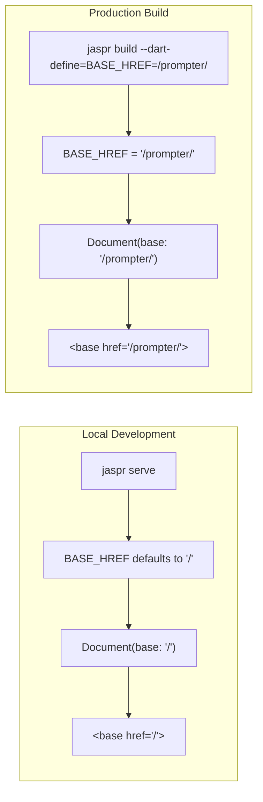

# Requirements

### Overview & Goals
When deployed to subpath hosting at `https://filiph.net/prompter/`, the web application currently fails to load client-side JavaScript (`main.client.dart.js`) because Jaspr's server renderer emits `<base href="/">` by default. The goal is to make the base href configurable at build time via a Dart compile-time environment variable (`BASE_HREF`), while defaulting to `'/'` so local development (`jaspr serve`) and default builds continue to work seamlessly out of the box without extra arguments.

### Scope
- **In Scope:**
  - Update `lib/main.server.dart` to read `BASE_HREF` from environment definitions via `const String.fromEnvironment('BASE_HREF', defaultValue: '/')` and pass it to `Document(base: ...)`.
  - Update `README.md` with the updated `jaspr build --dart-define=BASE_HREF=/prompter/` build command under `## Deploy`.
  - Validate that default builds generate `<base href="/">` and targeted builds generate `<base href="/prompter/">`.
- **Out of Scope:**
  - Changes to client-side application logic or styling in `lib/app.dart`.
  - Changes to local server port or hosting backend.

### User Stories
- **As a developer deploying to filiph.net/prompter/**, I want the build command to generate an HTML document with `<base href="/prompter/">` so that client scripts (`main.client.dart.js`) and other assets load from `https://filiph.net/prompter/` rather than the domain root.
- **As a developer running locally**, I want `jaspr serve` and standard `jaspr build` to continue using `/` without having to supply additional configuration or flags.

### Functional Requirements
- When built or served without flags, the rendered HTML `<head>` must contain `<base href="/">`.
- When built with `--dart-define=BASE_HREF=/prompter/`, the rendered HTML `<head>` must contain `<base href="/prompter/">`.
- Client script `<script src="main.client.dart.js" defer></script>` in the generated HTML must resolve correctly relative to the configured base href.

# Technical Design

### Current Implementation
In `lib/main.server.dart`, `runApp` instantiates `Document` without specifying the `base` parameter:
```dart
void main() {
  runApp(
    Document(
      title: 'Script Prompter',
      styles: [...],
      body: const App(),
    ),
  );
}
```
Jaspr's `BaseDocument` has a default `base = '/'` and `_normalizedBase` normalizes any supplied value with leading and trailing slashes. `ClientScriptAdapter` attaches `<script src="main.client.dart.js" defer></script>` when a `<base>` element is present. Because `base` was left at default `'/'`, the browser resolves `main.client.dart.js` against `https://filiph.net/`, causing a 404 on `https://filiph.net/prompter/`.

### Key Decisions
- **`--dart-define` Configuration:** Use `const String.fromEnvironment('BASE_HREF', defaultValue: '/')` to configure the base href. This is natively supported by Jaspr CLI (`--dart-define`) and Dart compilers.
- **Safe Fallback:** Defaulting to `'/'` ensures zero disruption to local development with `jaspr serve` or unit/component tests.
- **Naming Convention:** Use `BASE_HREF` to directly correspond to the HTML `<base href="...">` and Jaspr's `Document(base: ...)` attribute name.

### Proposed Changes
1. **`lib/main.server.dart`:**
   - Define `const baseHref = String.fromEnvironment('BASE_HREF', defaultValue: '/');`.
   - Pass `base: baseHref` to `Document(...)`.

2. **`README.md`:**
   - Update `## Deploy` section with the new build invocation: `jaspr build --dart-define=BASE_HREF=/prompter/`.

### Architecture Diagram


### Risks & Mitigations
- **Missing trailing slash in define flag:** Jaspr's `BaseDocument._normalizedBase` automatically handles leading and trailing slashes (`/prompter/`, `prompter`, `/prompter` all normalize to `/prompter/`).

# Testing

### Validation Approach
Verify that the `Document` configuration responds properly to environment definitions during both standard and customized builds.

### Key Scenarios
1. **Default Build Verification:**
   - Run `jaspr build`.
   - Check `build/jaspr/index.html` to confirm `<base href="/">` is present and `<script src="main.client.dart.js" defer>` is included.
2. **Subpath Build Verification:**
   - Run `jaspr build --dart-define=BASE_HREF=/prompter/`.
   - Check `build/jaspr/index.html` to confirm `<base href="/prompter/">` is present and `<script src="main.client.dart.js" defer>` is included.
3. **Local Dev Server Check:**
   - Run `dart analyze` to ensure there are no static analysis warnings or compilation issues.

# Delivery Steps

### ✓ Step 1: Make Document base href configurable via BASE_HREF environment variable
`Document` in `lib/main.server.dart` dynamically consumes the `BASE_HREF` environment define with `'/'` as the default value.

- Declare `const baseHref = String.fromEnvironment('BASE_HREF', defaultValue: '/');` in `lib/main.server.dart`.
- Pass `base: baseHref` to the `Document(...)` constructor in `runApp()`.
- Ensure local development with `jaspr serve` continues to resolve to `/` without requiring additional CLI flags.

### ✓ Step 2: Update deployment instructions in README.md and verify build outputs
The deployment section in `README.md` reflects the `--dart-define=BASE_HREF=/prompter/` build flag.

- Update the `## Deploy` section in `README.md` to specify `jaspr build --dart-define=BASE_HREF=/prompter/`.
- Validate static build output by running `jaspr build` (verifying `<base href="/">` in generated `index.html`) and `jaspr build --dart-define=BASE_HREF=/prompter/` (verifying `<base href="/prompter/">` and proper asset paths).